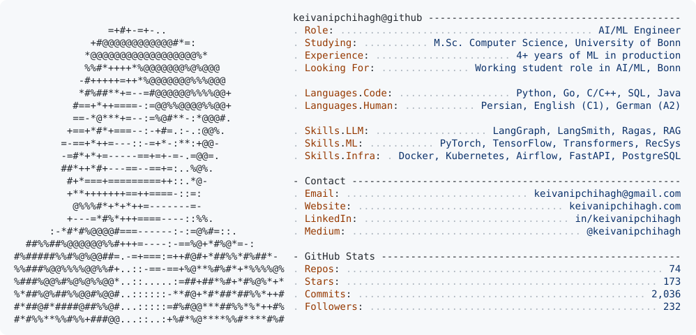

<a href="https://keivanipchihagh.com">
  <picture>
    <source media="(prefers-color-scheme: dark)" srcset="assets/profile-dark.svg">
    
  </picture>
</a>

[Website](https://keivanipchihagh.com) · [LinkedIn](https://www.linkedin.com/in/keivanipchihagh/) · [Medium](https://medium.com/@keivanipchihagh) · [Email](mailto:keivanipchihagh@gmail.com)

**Selected work:** [Two-tower recommender](https://github.com/keivanipchihagh/multi-stage-two-tower-recommender) · [Easy Peasy Deployment](https://github.com/keivanipchihagh/easy-peasy-deployment) · [Serving deep learning models in production](https://medium.com/@keivanipchihagh/what-we-learned-about-serving-deep-learning-models-in-production-9f22b84ad770) · [Tuning HNSW for vector search](https://medium.com/@keivanipchihagh/your-vectordb-needs-a-tune-up-hnsw-fine-tuning-explained-627a351e230b)
