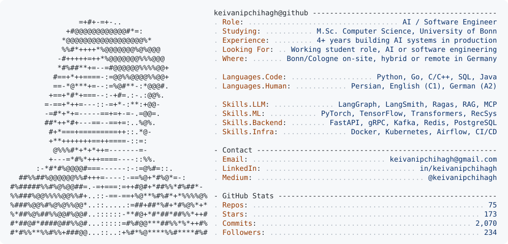

<a href="https://www.linkedin.com/in/keivanipchihagh/">
  <picture>
    <source media="(prefers-color-scheme: dark)" srcset="assets/profile-dark.svg">
    
  </picture>
</a>

[LinkedIn](https://www.linkedin.com/in/keivanipchihagh/) · [Medium](https://medium.com/@keivanipchihagh) · [Email](mailto:keivanipchihagh@gmail.com)

I build AI systems and the software around them: LLM agents, RAG and recommender systems, most recently a shopping assistant with 20+ tools at Partnerz and a feed recommender for 35M users at Bale Messenger. I'm now doing my M.Sc. in Computer Science at the University of Bonn and looking for a working student role in AI or software engineering.

**Selected work**

- [Expense Tracker](https://github.com/keivanipchihagh/expense-tracker): a Go MCP server, REST API and web UI that let AI agents log and query expenses, with built-in OAuth 2.1
- [Two-tower recommender](https://github.com/keivanipchihagh/multi-stage-two-tower-recommender): multi-stage movie recommender with TensorFlow Recommenders, served with FastAPI
- [Easy Peasy Deployment](https://github.com/keivanipchihagh/easy-peasy-deployment): Docker setups for Grafana, Prometheus, Airflow, Spark and Postgres

**Writing**

- [What we learned about serving deep learning models in production](https://medium.com/@keivanipchihagh/what-we-learned-about-serving-deep-learning-models-in-production-9f22b84ad770)
- [Your VectorDB needs a tune-up: HNSW fine-tuning explained](https://medium.com/@keivanipchihagh/your-vectordb-needs-a-tune-up-hnsw-fine-tuning-explained-627a351e230b)
